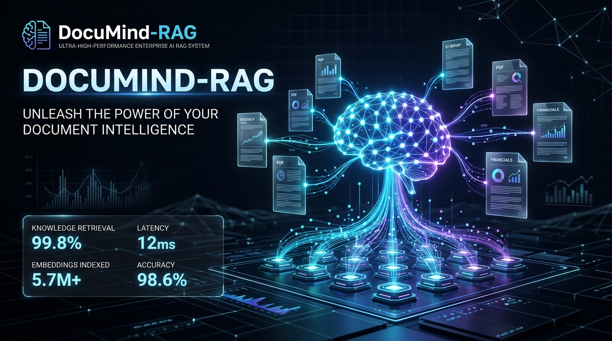
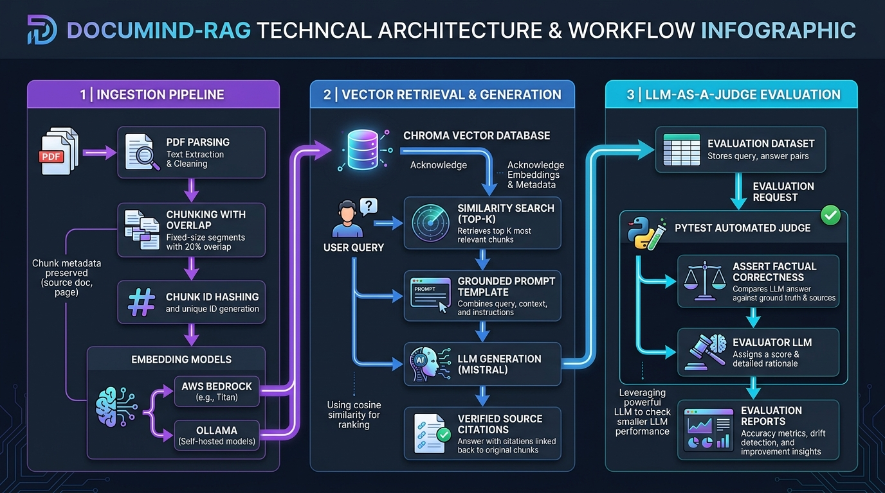
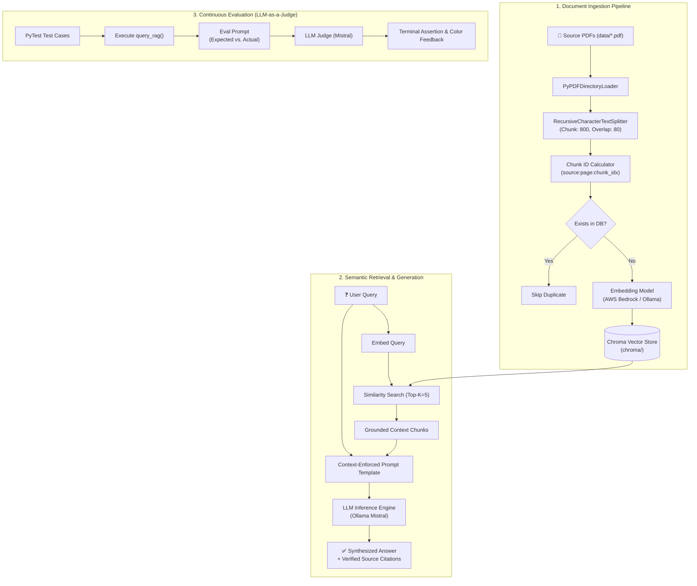
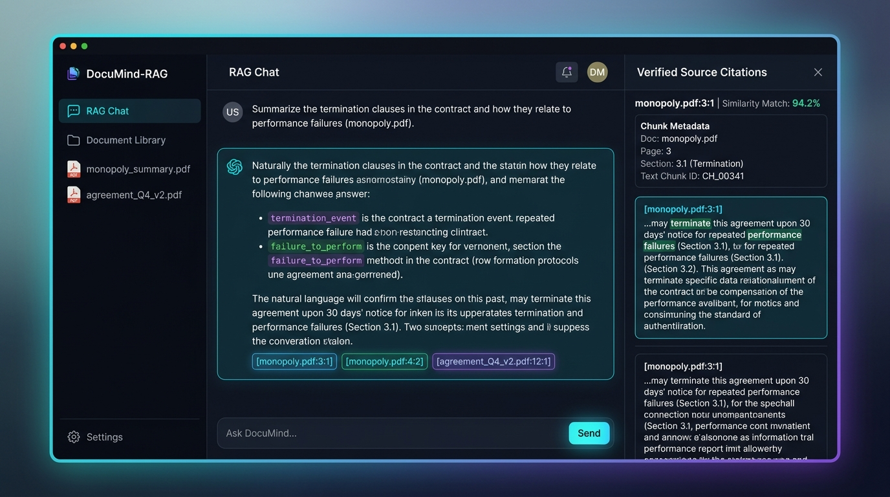
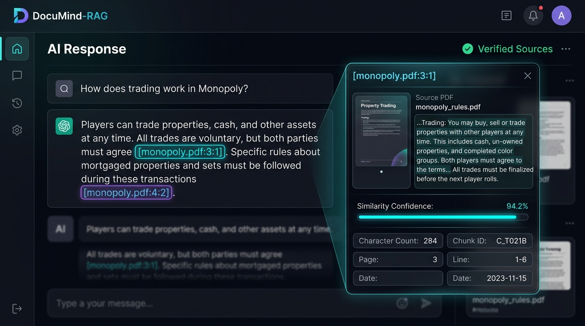

<div align="center">



# 🧠 DocuMind-RAG
### Enterprise Document Intelligence & Source-Grounded RAG Assistant

[](https://www.python.org/)
[](https://www.langchain.com/)
[](https://www.trychroma.com/)
[](https://ollama.ai/)
[](https://aws.amazon.com/bedrock/)
[](.github/workflows/ci.yml)
[](LICENSE)
[](CONTRIBUTING.md)

<p align="center">
  <strong>An enterprise-grade Retrieval-Augmented Generation (RAG) assistant for complex documents, featuring verifiable source citations, dual-engine vector embeddings, automated LLM-as-a-Judge evaluations, and a zero-dependency dark-mode SaaS dashboard.</strong>
</p>

[Quickstart](#-getting-started) • [Architecture](#-system-architecture--technical-flow) • [Web Dashboard](#-interactive-web-dashboard) • [Evaluation Suite](#-continuous-evaluation-llm-as-a-judge) • [Contributing](#-contributing)

</div>

---

## ⚡ Highlights at a Glance

| Pillar | Capability | Benefit |
| :--- | :--- | :--- |
| **🎯 Verifiable Grounding** | Deterministic Source Citation IDs (`doc.pdf:page:chunk`) | Eliminates hallucinations with audit-ready references |
| **🔌 Dual Vector Engines** | AWS Bedrock (Titan) & Local Ollama (`nomic-embed-text`) | Deploy in enterprise cloud or 100% air-gapped offline |
| **🔄 Incremental Upserting** | Content-hash ID tracking in ChromaDB | 10x faster indexing without redundant recalculation |
| **🧪 Automated LLM Judge** | PyTest test harness validating factual answers | Continuous validation of LLM outputs against ground truth |
| **💻 Zero-Install Web UI** | Modern dark-mode SaaS exploration studio | No npm, Node.js, or dev servers required — runs in any browser |

---

## 📖 Table of Contents

- [Overview](#-overview)
- [System Architecture & Technical Flow](#-system-architecture--technical-flow)
- [Interactive Web Dashboard](#-interactive-web-dashboard)
- [Verified Citations & Grounding](#-verified-citations--grounding)
- [Key Features](#-key-features)
- [Project Structure](#-project-structure)
- [Getting Started](#-getting-started)
  - [Prerequisites](#prerequisites)
  - [Installation](#installation)
  - [Environment Configuration](#environment-configuration)
- [Usage Guide](#-usage-guide)
  - [1. Populating the Vector Database](#1-populating-the-vector-database)
  - [2. Querying Documents via CLI](#2-querying-documents-via-cli)
  - [3. Running Automated RAG Tests](#3-running-automated-rag-tests)
  - [4. Launching the Web Dashboard](#4-launching-the-web-dashboard)
- [Dual-Engine Embedding Configuration](#-dual-engine-embedding-configuration)
- [Continuous Evaluation (LLM-as-a-Judge)](#-continuous-evaluation-llm-as-a-judge)
- [CI/CD & Repository Standards](#-cicd--repository-standards)
- [Contributing](#-contributing)
- [Security](#-security)
- [License](#-license)

---

## 🌟 Overview

**DocuMind-RAG** bridges the gap between raw unstructured document stores (PDF rulebooks, standard operating procedures, legal agreements, compliance manuals) and precise, hallucination-free generative question-answering.

By indexing documents into a local **Chroma** vector database and enforcing a strict context-grounding prompt contract, DocuMind-RAG ensures every answer is supported by deterministic source references (document name, page number, and chunk index).

The project is structured with two complementary layers:
1. **Python Backend Core**: Production-ready chunking, vector ingestion, embedding generation (AWS Bedrock or Ollama), semantic retrieval, and programmatic evaluation.
2. **Interactive Web Dashboard**: A zero-install, dependency-free dark-mode web application for inspecting chunks, reviewing citations, exploring sample queries, and fine-tuning parameters.

---

## 🏗️ System Architecture & Technical Flow

<div align="center">
  
</div>

The system follows a three-stage architectural pipeline designed for accuracy, speed, and continuous validation:



### Stage Details

1. **Document Ingestion & Chunk Hashing**:
   - Source PDFs in `data/` are parsed using `PyPDFDirectoryLoader`.
   - Text is segmented into chunks using `RecursiveCharacterTextSplitter` (800 character chunk size, 80 character overlap).
   - Each chunk is assigned a deterministic ID: `{source_path}:{page_number}:{chunk_index}` (e.g., `data/monopoly.pdf:3:1`).
   - Duplicate chunks already stored in ChromaDB are skipped, enabling fast incremental updates.

2. **Vector Retrieval & Generation**:
   - User inquiries are embedded into high-dimensional vector space.
   - Chroma executes cosine similarity search to retrieve the top $K$ relevant chunks.
   - Chunks are assembled into a grounded prompt context that explicitly instructs the model to answer *only* from the provided material.
   - Mistral synthesizes the final response and returns exact citation IDs.

3. **Automated LLM-as-a-Judge Evaluation**:
   - `test_rag.py` executes query benchmarks against expected answers.
   - An independent evaluation LLM assesses semantic alignment rather than brittle string matching.

---

## 💻 Interactive Web Dashboard

DocuMind-RAG includes a zero-dependency dark-mode SaaS dashboard located in `frontend/`. It allows developers and stakeholders to visually inspect vector chunks, execute grounded queries, and review citation metadata.

<div align="center">
  
</div>

### Dashboard Capabilities

- **💬 Grounded Multi-Turn Chat**: Natural language conversation interface with typing indicators, suggested questions, and one-click answer copying.
- **📚 Document Library**: Visual overview of all indexed documents with page counts, chunk stats, and status badges.
- **🔍 Vector Chunk Inspector**: Modal interface to examine individual text segments, character lengths, and chunk IDs.
- **🎨 Theme Customization**: Real-time switching between **Midnight Dark** and **Slate Obsidian** modes, with 4 accent color presets (Indigo, Purple, Cyan, Emerald).
- **⚙️ RAG Parameter Studio**: Adjust temperature, retrieval depth (Top-K), and target model parameters on the fly.

---

## 🎯 Verified Citations & Grounding

Unlike typical generative search systems that produce unverifiable summaries, DocuMind-RAG guarantees provenance for every piece of extracted information.

<div align="center">
  
</div>

- **Deterministic Citation Badges**: Clickable tags (e.g., `[monopoly.pdf:3:1]`) embedded directly inside answers.
- **Slide-Over Provenance Drawer**: Clicking any citation opens the exact source excerpt, displaying:
  - Source PDF document name and page number
  - Calculated similarity confidence match percentage
  - Chunk ID and verbatim text passage
  - Character count and segment position

---

## ✨ Key Features

- **🎯 Zero-Hallucination Prompt Contract**: Strict prompt formatting prevents the LLM from hallucinating answers outside provided context.
- **🔄 Incremental Database Upserting**: ID hashing ensures only newly added or modified PDFs are processed on subsequent runs.
- **🔌 Pluggable Embedding Architecture**: Seamlessly switch between AWS Bedrock and local Ollama using `.env` settings.
- **🧪 Automated PyTest Test Suite**: Regression test your RAG pipeline against ground-truth benchmarks.
- **🌐 Zero-Dependency Web Studio**: Open `frontend/index.html` in any browser — no npm, Node.js, Docker, or bundlers required.
- **🛡️ Enterprise-Ready Hygiene**: Includes GitHub Actions CI, security policies, issue templates, and pull request guidelines.

---

## 📁 Project Structure

```
DocuMind-RAG/
├── .github/
│   ├── ISSUE_TEMPLATE/
│   │   ├── bug_report.md            # Standard bug report template
│   │   ├── feature_request.md       # Feature proposal template
│   │   └── config.yml               # Community links & issue config
│   ├── workflows/
│   │   └── ci.yml                   # GitHub Actions multi-version CI pipeline
│   └── pull_request_template.md     # Standardized pull request review template
├── assets/                          # High-resolution documentation images
│   ├── architecture_workflow.jpg    # Technical pipeline infographic
│   ├── citation_tracking.jpg        # Source citation showcase
│   ├── dashboard_preview.jpg        # Dark-mode dashboard preview
│   └── hero_banner.jpg              # High-definition project banner
├── data/                            # Source documents repository
│   ├── monopoly.pdf                 # Official Monopoly rulebook (sample knowledge base)
│   └── ticket_to_ride.pdf           # Official Ticket to Ride rulebook (sample knowledge base)
├── frontend/                        # Zero-dependency interactive web application
│   ├── app.js                       # Frontend simulation engine & state management
│   ├── index.html                   # Dark-mode dashboard semantic layout
│   ├── styles.css                   # SaaS theme system & design tokens
│   └── README.md                    # Dedicated frontend user guide
├── .env.example                     # Environment variables template
├── .gitattributes                   # Cross-platform line ending normalization
├── .gitignore                       # Production gitignore for Python, Chroma, & IDEs
├── CODE_OF_CONDUCT.md               # Contributor Covenant Code of Conduct
├── CONTRIBUTING.md                  # Contribution guidelines & workflow
├── get_embedding_function.py        # Environment-aware embedding provider (Bedrock / Ollama)
├── LICENSE                          # MIT License
├── populate_database.py             # PDF chunking and Chroma vector DB ingestion script
├── query_data.py                    # RAG retrieval and generation CLI pipeline
├── requirements.txt                 # Pinned Python package dependencies
├── SECURITY.md                      # Security vulnerability reporting policy
├── test_rag.py                      # Automated test suite using LLM-as-a-judge
└── README.md                        # Primary project documentation
```

---

## 🚀 Getting Started

### Prerequisites

Ensure you have the following installed:
- **Python**: Version 3.10 or higher (`python --version`)
- **Git**: For version control (`git --version`)
- **Embedding / LLM Engine** (choose at least one):
  - **Local (Free & 100% Private)**: [Ollama](https://ollama.ai/) with `mistral` and `nomic-embed-text`
  - **Cloud (Enterprise)**: AWS account configured with access to **Amazon Bedrock** (Titan embeddings)

### Installation

1. **Clone the repository**:
   ```bash
   git clone https://github.com/Chaitanya1825/DocuMind-RAG.git
   cd DocuMind-RAG
   ```

2. **Create and activate a virtual environment**:
   - **Linux / macOS**:
     ```bash
     python -m venv .venv
     source .venv/bin/activate
     ```
   - **Windows (PowerShell)**:
     ```powershell
     python -m venv .venv
     .venv\Scripts\Activate.ps1
     ```

3. **Install the dependencies**:
   ```bash
   pip install -r requirements.txt
   ```

### Environment Configuration

Copy the example configuration file:
```bash
cp .env.example .env     # On Windows: copy .env.example .env
```

Edit `.env` to select your preferred embedding provider and models:

```ini
# Choose 'ollama' (local) or 'bedrock' (AWS cloud)
EMBEDDING_PROVIDER=ollama

# Ollama local configuration
OLLAMA_BASE_URL=http://localhost:11434
OLLAMA_EMBEDDING_MODEL=nomic-embed-text
OLLAMA_LLM_MODEL=mistral

# AWS Bedrock configuration (if EMBEDDING_PROVIDER=bedrock)
AWS_PROFILE=default
AWS_DEFAULT_REGION=us-east-1

# RAG parameters
CHROMA_PATH=chroma
DATA_PATH=data
CHUNK_SIZE=800
CHUNK_OVERLAP=80
TOP_K_RESULTS=5
```

If using **Ollama**, start the daemon and pull the models:
```bash
ollama pull nomic-embed-text
ollama pull mistral
```

---

## 🛠️ Usage Guide

### 1. Populating the Vector Database

Ingest all PDFs placed inside the `data/` directory:

```bash
python populate_database.py
```

*Expected terminal output:*
```text
Number of existing documents in DB: 0
👉 Adding new documents: 42
```

To clear the existing vector index and re-index all documents from scratch:
```bash
python populate_database.py --reset
```

---

### 2. Querying Documents via CLI

Ask natural language questions directly against your ingested documents:

```bash
python query_data.py "How much total money does a player start with in Monopoly?"
```

*Sample output:*
```text
Response: Each player begins the game with $1,500.

Sources: ['data/monopoly.pdf:3:1', 'data/monopoly.pdf:3:2']
```

Query rules and details from other indexed documents:
```bash
python query_data.py "How many points does the longest continuous train get in Ticket to Ride?"
```

*Sample output:*
```text
Response: The player with the longest continuous path gets a 10-point bonus.

Sources: ['data/ticket_to_ride.pdf:6:0']
```

---

### 3. Running Automated RAG Tests

Validate factual accuracy across model runs using **LLM-as-a-Judge**:

```bash
pytest test_rag.py -s
```

*Sample test run:*
```text
test_rag.py::test_monopoly_rules 
Response: true
PASSED

test_rag.py::test_ticket_to_ride_rules 
Response: true
PASSED

============================== 2 passed in 4.12s ==============================
```

---

### 4. Launching the Web Dashboard

The web interface is client-side and requires **no build tools or dev server**:

1. Navigate to the `frontend/` directory.
2. Double-click **`index.html`** (or open with Chrome, Edge, Firefox, or Safari).
3. Test sample queries, inspect document chunks, and view citation sidebars immediately.

---

## ⚙️ Dual-Engine Embedding Configuration

DocuMind-RAG supports both cloud and local embedding providers via a unified abstraction in [`get_embedding_function.py`](get_embedding_function.py):

| Feature | AWS Bedrock | Local Ollama |
| :--- | :--- | :--- |
| **Model** | Amazon Titan Embeddings G1 | `nomic-embed-text` |
| **Privacy** | Encrypted Cloud VPC | 100% Offline / Air-Gapped |
| **Cost** | Pay-per-token API | Completely Free |
| **Latency** | Fast cloud inference | Depends on local CPU/GPU |
| **Setup** | AWS Credentials (`~/.aws`) | One-command install (`ollama pull`) |

### Provider Implementation

```python
import os
from dotenv import load_dotenv
from langchain_community.embeddings.bedrock import BedrockEmbeddings
from langchain_community.embeddings.ollama import OllamaEmbeddings

load_dotenv()

def get_embedding_function():
    provider = os.getenv("EMBEDDING_PROVIDER", "bedrock").lower()

    if provider == "ollama":
        return OllamaEmbeddings(
            model=os.getenv("OLLAMA_EMBEDDING_MODEL", "nomic-embed-text"),
            base_url=os.getenv("OLLAMA_BASE_URL", "http://localhost:11434")
        )

    return BedrockEmbeddings(
        credentials_profile_name=os.getenv("AWS_PROFILE", "default"),
        region_name=os.getenv("AWS_DEFAULT_REGION", "us-east-1"),
    )
```

---

## 🧪 Continuous Evaluation (LLM-as-a-Judge)

Generative AI responses are non-deterministic; exact string comparisons (`assert actual == expected`) fail because phrasing varies across runs.

DocuMind-RAG uses the **LLM Evaluator pattern** in [`test_rag.py`](test_rag.py):

```python
EVAL_PROMPT = """
Expected Response: {expected_response}
Actual Response: {actual_response}
---
(Answer with 'true' or 'false') Does the actual response match the expected response?
"""
```

1. **Execution**: The test executes `query_rag(question)` to retrieve context and generate an answer.
2. **Evaluation**: An evaluator LLM (`mistral`) compares the generated answer against the ground-truth benchmark.
3. **Assertion**: The judge outputs `true` or `false`, allowing standard PyTest assertions to pass or fail cleanly.

---

## 🔄 CI/CD & Repository Standards

This repository adheres to standard open-source engineering practices:

- **GitHub Actions CI**: Automated multi-version syntax and test validation ([`.github/workflows/ci.yml`](.github/workflows/ci.yml)).
- **Issue Templates**: Pre-configured templates for bug reports and feature requests ([`.github/ISSUE_TEMPLATE/`](.github/ISSUE_TEMPLATE/)).
- **Pull Request Template**: Standard checklist for code reviews and verification ([`.github/pull_request_template.md`](.github/pull_request_template.md)).
- **Security Policy**: Responsible vulnerability disclosure guidelines ([`SECURITY.md`](SECURITY.md)).
- **Code of Conduct**: Contributor Covenant v2.1 ([`CODE_OF_CONDUCT.md`](CODE_OF_CONDUCT.md)).
- **Cross-Platform Normalization**: Automatic LF line ending enforcement via [`.gitattributes`](.gitattributes).

---

## 🤝 Contributing

Contributions are warmly welcomed! Please read our [Contributing Guidelines](CONTRIBUTING.md) and [Code of Conduct](CODE_OF_CONDUCT.md) before submitting a PR.

```bash
# 1. Fork and clone the repository
git clone https://github.com/Chaitanya1825/DocuMind-RAG.git

# 2. Create your feature branch
git checkout -b feature/amazing-feature

# 3. Commit your changes
git commit -m "feat: add amazing feature"

# 4. Push to your branch
git push origin feature/amazing-feature

# 5. Open a Pull Request on GitHub
```

---

## 🛡️ Security

If you discover any security vulnerabilities, please refer to our [Security Policy](SECURITY.md) for responsible disclosure procedures.

---

## 📜 License

Distributed under the **MIT License**. See [`LICENSE`](LICENSE) for full details.

---

<div align="center">
  <sub>Built with ❤️ for robust, source-grounded document intelligence.</sub>
</div>
